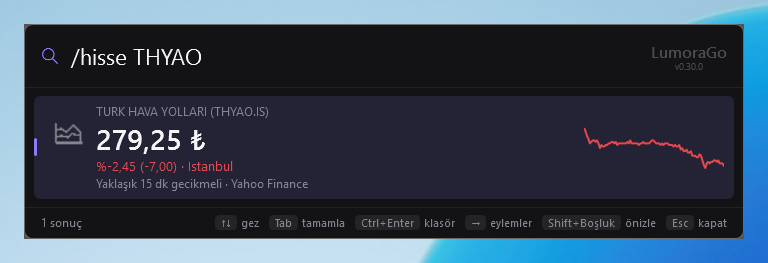
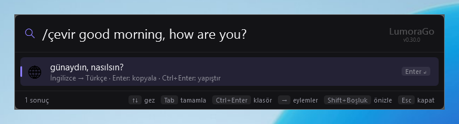
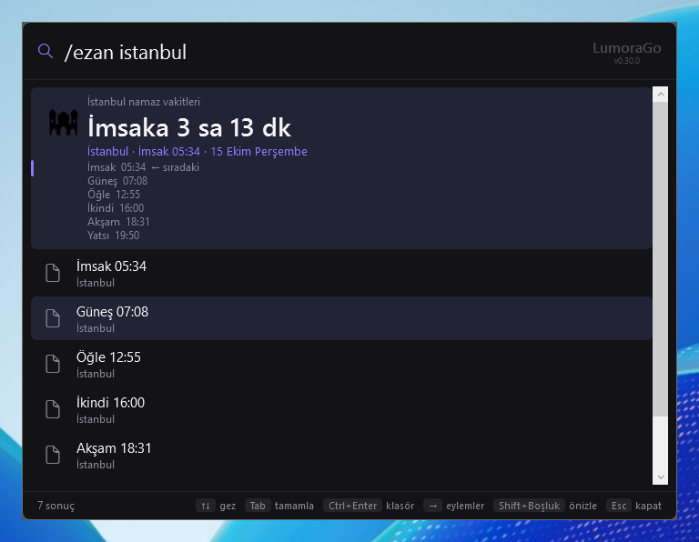
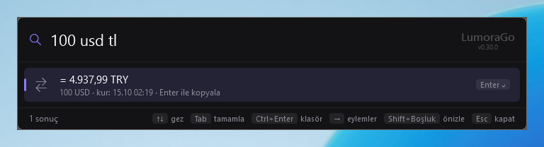
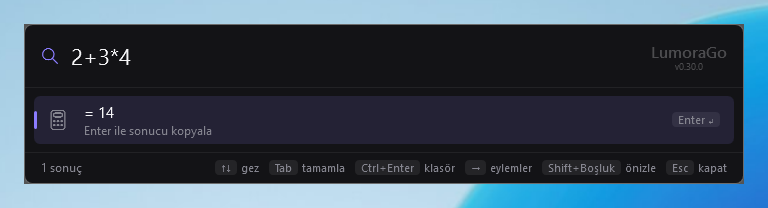
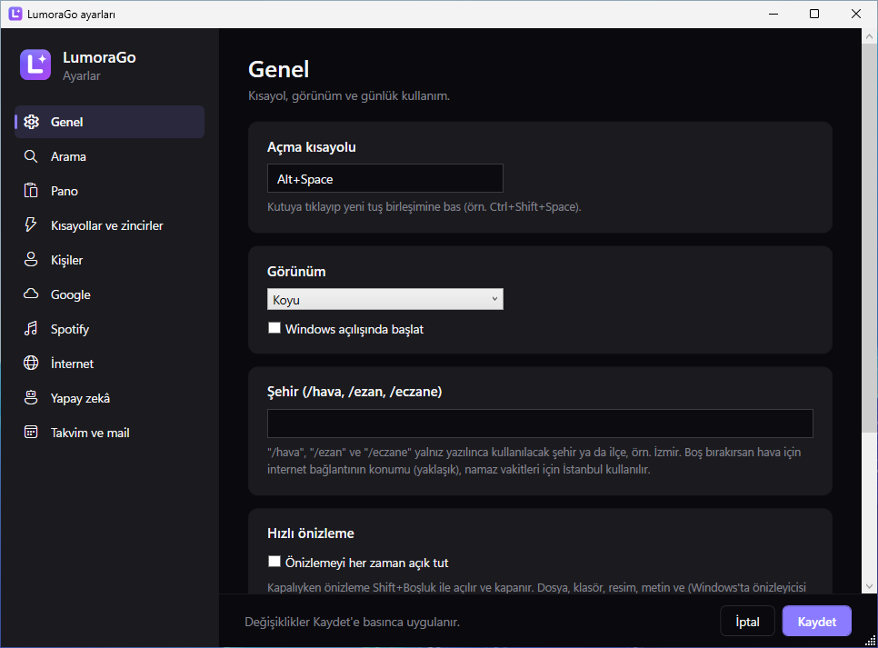

<p align="center"></p>

# LumoraGo

Alt+Space ile açılan, her özelliği bir eklenti olan Windows launcher'ı (Raycast / Spotlight / PowerToys Run tarzı). Uygulama, dosya, hesap, döviz, hava, haber, takvim, Gmail, Spotify, yapay zekâ ve daha fazlası tek kutuda.

<p align="center"></p>

## Ekran görüntüleri

| | |
|---|---|
| <br>`/sistem` işlemci, bellek, disk ve pil | <br>`/hava istanbul` bilgi kartı |
| <br>`/haber` son başlıklar | <br>`/temizle` disk temizliği |
| <br>`/hisse THYAO` | <br>`/çevir` anında çeviri |
| <br>`/ezan` namaz vakitleri | <br>`100 usd tl` |
| <br>`2+3*4` hesap makinesi | <br>`/liste` tüm komutlar |

<p align="center"><br>Ayarlar</p>

Görüntüler `tools/screenshots.ps1` ile temiz bir Windows'ta çekilir; GitHub'da **Actions → Screenshots → Run workflow** ile yenilenir.

## Kurulum ve güncelleme

[Releases](https://github.com/highlvmami/LumoraGO/releases) sayfasındaki `LumoraGo-win-Setup.exe` ile kur. LumoraGo yeni sürümü kendisi bulur, indirir ve launcher gizlenince sessizce yeniden başlar. Hemen güncellemek için `/güncelle`, sürüm notları için `/v` yaz.

## Kullanım

| Tuş | Ne yapar |
|---|---|
| Alt+Space | Aç / gizle |
| ↑ / ↓ | Sonuçlarda gez |
| Enter | Seçili sonucu çalıştır |
| Tab | Seçili sonucu kutuya tamamla |
| → ya da Ctrl+K | Ek eylemler |
| Shift+Boşluk | Hızlı önizleme |
| Ctrl+Enter | Klasörü aç / yapıştır (sonuca göre) |
| Shift+Enter | Yönetici olarak çalıştır |
| Esc | Gizle (odak kaybında da gizlenir) |

`/liste` yazınca tüm komutlar A'dan Z'ye listelenir. Sık seçtiğin sonuçlar o yazı için zamanla en üste çıkar. Bir sonucu fareyle tutup başka pencereye sürükleyebilirsin.

### Bilgisayar

| Komut | Ne yapar |
|---|---|
| `vsc`, `not` | Uygulamaları bulanık aramayla bulur |
| `/f rapor`, `/ds şifre` | Dosya adında anında arama; `/ds` tüm diskte ve dosya içinde arar |
| `/sistem` | İşlemci, bellek, disk, pil ve en çok bellek kullanan uygulamalar |
| `/temizle` | Geçici dosyalar, Geri Dönüşüm Kutusu, tarayıcı önbellekleri, hata raporları |
| `/başlangıç` | Windows açılışında başlayan uygulamaları aç / kapat |
| `/kill chrome` | Donan uygulamayı kapatır |
| `/w chrome` | Açık pencereye geçer |
| `sol yarı`, `sağ üst`, `tam ekran`, `diğer ekran` | Öndeki pencereyi yerleştirir (`/pencere`) |
| `/ses 40`, `/kilit`, `/uyku`, `/kapat`, `/yeniden` | Ses ve güç |
| `bluetooth`, `/ayarlar` | Windows Ayarları sayfaları |
| `/ocr` | Ekranda seçtiğin bölgedeki yazıyı kopyalar |
| `/c` | Pano geçmişi |
| `;adres`, `/metin` | Hazır metinler |
| `/t 10dk çay` | Zamanlayıcı |
| Betikler | `%LOCALAPPDATA%\LumoraGo\scripts` içindeki .ps1, .bat, .cmd, .py dosyalarını adıyla çalıştırır |

### İnternet

| Komut | Ne yapar |
|---|---|
| `/hava`, `/hava izmir yarın` | Hava durumu kartı |
| `/haber`, `/haber bbc`, `/haber deprem` | Haber sitelerinin son başlıkları (kaynaklar Ayarlar → İnternet) |
| `/çevir merhaba`, `/çevir de günaydın` | Çeviri; boşsa panodakini çevirir |
| `/film inception`, `/dizi` | Puan, tür, özet ve Türkiye'de hangi platformda (TMDB anahtarı gerekir) |
| `/hisse THYAO`, `/hisse btc` | Hisse ve kripto |
| `100 usd tl`, `5 km mil` | Döviz ve birim çevirme |
| `/mac fenerbahçe`, `/lig` | Maç skorları ve puan tablosu |
| `TK1980` | Uçuş takibi |
| `/ezan`, `/eczane` | Namaz vakitleri, nöbetçi eczane |
| `/tanım kelime` | Sözlük |
| `/gg`, `/yt`, `/wiki`, `/harita`, `/tr` | Web'de arama |
| `/ping`, `/dns`, `/whois`, `/hiz`, `/disip` | Ağ araçları |
| `? soru`, `/ai özetle` | Claude'a sor (API anahtarı gerekir) |

### Hesaplar

| Komut | Ne yapar |
|---|---|
| `/gmail`, `/gmail from:ali` | Okunmamış mailler ve Gmail araması, yeni mail bildirimi |
| `/takvim`, `etkinlik cuma 14:00 dişçi` | Google Takvim |
| `/görev` | Google Görevler |
| `/drive bütçe` | Google Drive |
| `/foto` | Google Fotoğraflar ve Resimler klasörü |
| `/youtube` | Abonelikler, listeler, beğenilenler |
| `/kisi ahmet`, `mesaj ahmet geliyorum` | Google Rehber; Ctrl+Enter WhatsApp |
| `/spotify tarkan` | Spotify'da ara ve çal |
| `/mail` | IMAP ile okunmamış mailler (uygulama şifresiyle) |
| `hatırlat yarın 9 fatura`, `/not süt al` | Hatırlatıcı ve not |

Google, Spotify, TMDB ve Claude bağlantıları Ayarlar'dan bir kez yapılır; adımlar her bölümde yazar. Ayarlar: tepsi simgesine sağ tıkla → Ayarlar, ya da launcher'da `ayar` yaz.

## Gizlilik

Arama tamamen bilgisayarında yapılır. İnternete yalnızca güncelleme kontrolü, döviz kurları ve senin yazdığın komutlar (bilgi kartları, haber, çeviri, film, ağ araçları) ile bağladığın hesaplar için çıkılır. Şifreler, anahtarlar ve kişiler Windows hesabına bağlı şifreli dosyada saklanır; notlar, ayarlar ve (istenirse) pano geçmişi `%LOCALAPPDATA%\LumoraGo` altında durur. Ayrıntı: [PRIVACY.md](PRIVACY.md).

Günlükler: `%LocalAppData%\LumoraGo\logs`.

## Geliştirme

Gerekenler: Windows 10/11 ve [.NET 10 SDK](https://dotnet.microsoft.com/download).

```powershell
dotnet run --project src/LumoraGo.App
```

`dotnet run` ile çalışan kopyalar kendini güncellemez.

### Yeni sürüm çıkarmak

1. `Directory.Build.props` içindeki `<Version>` değerini artır.
2. `CHANGELOG.md` dosyasının başına `## X.Y.Z` başlığı ve altına `- ` ile başlayan maddeler ekle.
3. Birleştirdikten sonra GitHub'da **Actions → Release → Run workflow** ile başlat.

Release iş akışı testleri çalıştırır, kurulum dosyasını ve güncelleme paketlerini üretip GitHub Releases'a yükler.

## Yapı

```
src/
  LumoraGo.Plugin.Abstractions   Eklenti API'si (IPlugin, Query, Result). Küçük ve kararlı kalır.
  LumoraGo.Core                  Sorgu ayrıştırma, eklenti yönetimi, paralel arama. UI'dan bağımsız.
  LumoraGo.App                   WPF arayüzü: pencere, kısayol, tepsi, Windows entegrasyonu.
samples/
  LumoraGo.SamplePlugin          Örnek dış eklenti ("/merhaba"); kendi eklentin için başlangıç
tests/
  LumoraGo.Core.Tests            xUnit testleri
```

Arayüz sadece çekirdekle konuşur; çekirdek eklentileri yalnızca `IPlugin` üzerinden tanır. Arama her tuşta öncekini iptal eder, her eklenti paralel çalışır, 200 ms'yi aşan eklenti atlanır, hata veren eklenti launcher'ı çökertmez.

## Eklenti yazma

Dış eklentiler `%LOCALAPPDATA%\LumoraGo\extensions` altında, her biri kendi klasöründe durur. Launcher'da "eklenti" yazıp "LumoraGo eklenti klasörünü aç" ile açılır. Yeni eklenti LumoraGo yeniden başlatılınca yüklenir.

1. `samples/LumoraGo.SamplePlugin` projesini kopyala. `LumoraGo.Plugin.Abstractions`'a başvurur ve `IPlugin`'i uygular.
2. `plugin.json` içinde kimliği, görünen adı ve tetik kelimesini yaz:
   ```json
   { "id": "benim.eklentim", "name": "Benim eklentim", "keyword": "/benim" }
   ```
   `keyword` boşsa eklenti her aramaya katılır. `lumorago.` ile başlayan kimlikler yerleşik eklentilere ayrılmıştır. Klasörde birden fazla DLL varsa `"assembly": "Benim.dll"` ile hangisinin yükleneceği yazılır.
3. `dotnet build -c Release` çıktısını (`bin/Release/net10.0`) `extensions\benim` klasörüne kopyala.

Her eklenti kendi yükleme bağlamında çalışır, bağımlılıkları LumoraGo ile çakışmaz. Yüklenemeyen veya hata veren eklenti günlüğe yazılır ve atlanır. Eklentiler bilgisayarında LumoraGo'nun yetkileriyle çalışır; sadece güvendiğin eklentileri kur.

## Testler

```powershell
dotnet test
```

Core ve testler Linux/macOS'ta da çalışır. Uygulama projesi `EnableWindowsTargeting` sayesinde her yerde derlenir ama sadece Windows'ta çalışır.

## Yol haritası

Fazlar:

- [x] Faz 0: Hazırlık (depo, solution, CI)
- [x] Faz 1: İskelet (kısayol, tepsi, göster/gizle, sonuç listesi)
- [x] Faz 2: Uygulama başlatma ve bulanık arama → MVP
- [x] Faz 3: Eklenti sistemi (dış eklenti klasörü dahil)
- [x] Faz 4: Yerleşik eklentiler
- [x] Faz 5: Kısayollar, tema, ayarlar
- [ ] Faz 6: Performans ve yayın → 1.0 ← burada
