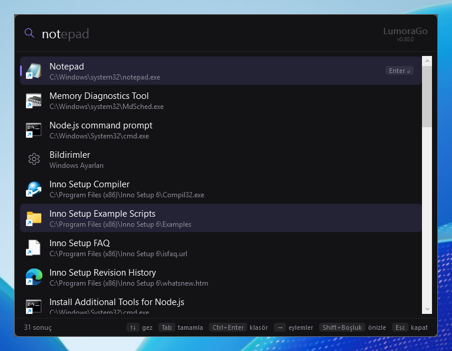
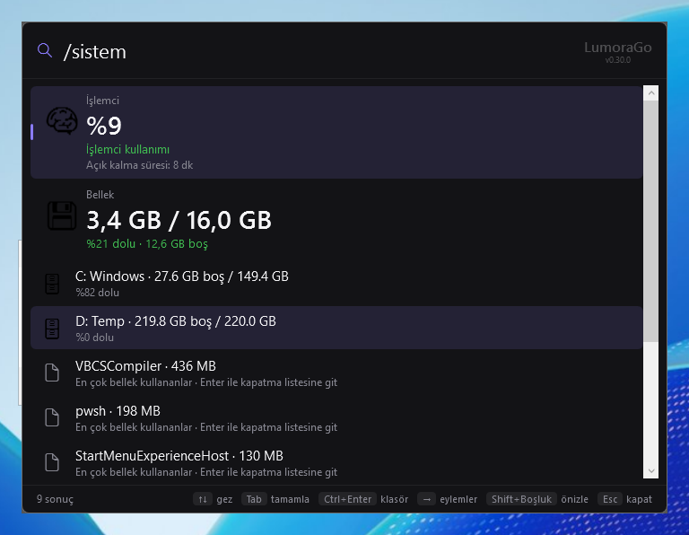
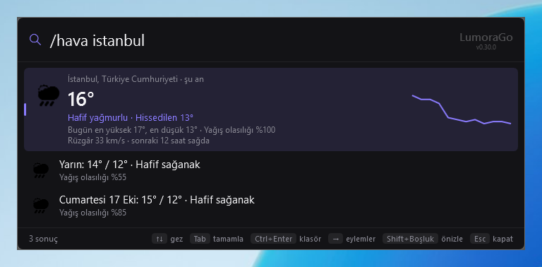
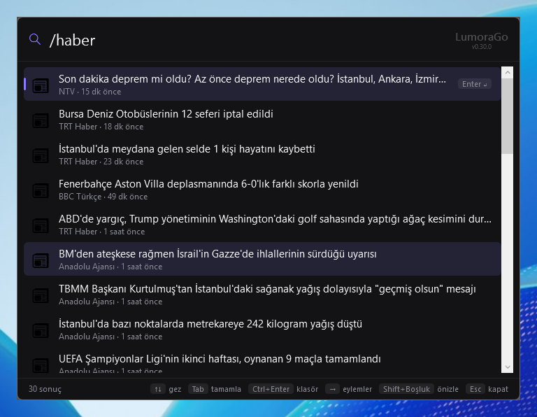
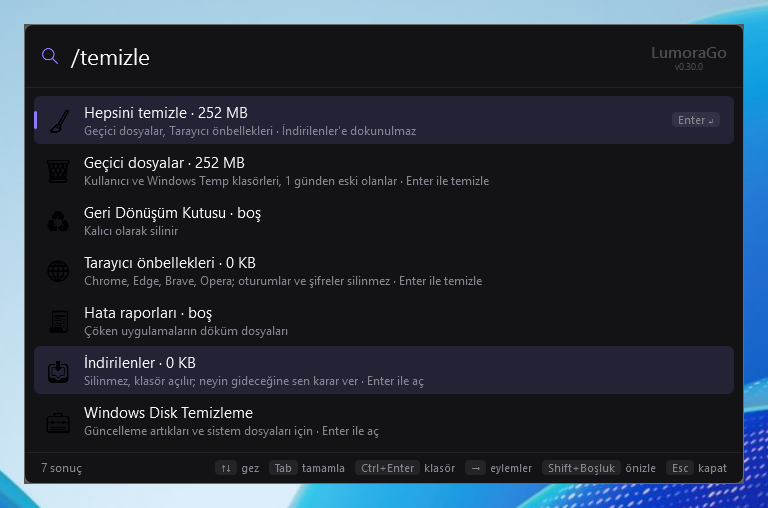

<h1 align="center">LumoraGo</h1>

<b>İnternet ve bilgisayar yönetimi tek satırda.</b> Alt+Space'e bas, yaz, Enter'a bas. Windows için Spotlight / Raycast tarzı launcher.

| | |
|---|---|
|  |  |
|  |  |

## Kurulum

[Releases](https://github.com/highlvmami/LumoraGO/releases) sayfasından `LumoraGo-win-Setup.exe`'yi indir ve kur. Güncellemeler kendiliğinden gelir.

## En çok kullanılanlar

| Yaz | Ne olur |
|---|---|
| `chrome`, `not` | Uygulamayı açar |
| `/f rapor` | Dosya bulur |
| `2+3*4`, `100 usd tl` | Hesap ve döviz |
| `/rehber`, `/kisi ahmet` | Kişiler; Ctrl+Enter WhatsApp |
| `/gmail` | Okunmamış mailler |
| `/takvim` | Bugünün etkinlikleri |
| `/hava`, `/haber` | Hava durumu ve son haberler |
| `/çevir merhaba` | Çeviri |
| `/sistem` | İşlemci, bellek, disk |
| `/temizle` | Gereksiz dosyaları siler |
| `/spotify tarkan` | Müzik |
| `? soru` | Yapay zekâya sor |

Tüm komutları görmek için launcher'da `/liste` yaz. Ayarlar için `ayar` yaz.

## Gizlilik

Arama bilgisayarında yapılır. Şifreler ve hesap bilgileri Windows hesabına bağlı şifreli dosyada durur. Ayrıntı: [PRIVACY.md](PRIVACY.md).

## Geliştirme

.NET 10 ve WPF. Çalıştırmak için `dotnet run --project src/LumoraGo.App`, testler için `dotnet test`. Kendi eklentini yazmak için `samples/LumoraGo.SamplePlugin`'e bak.
